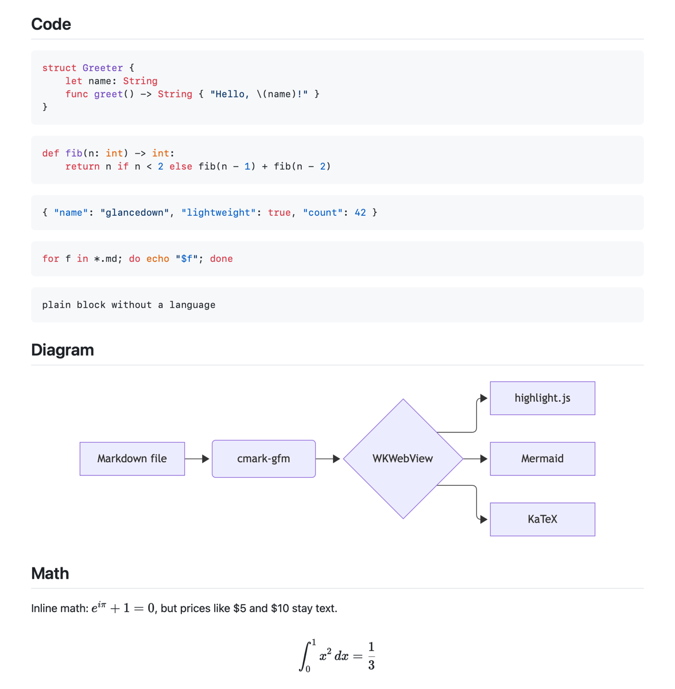
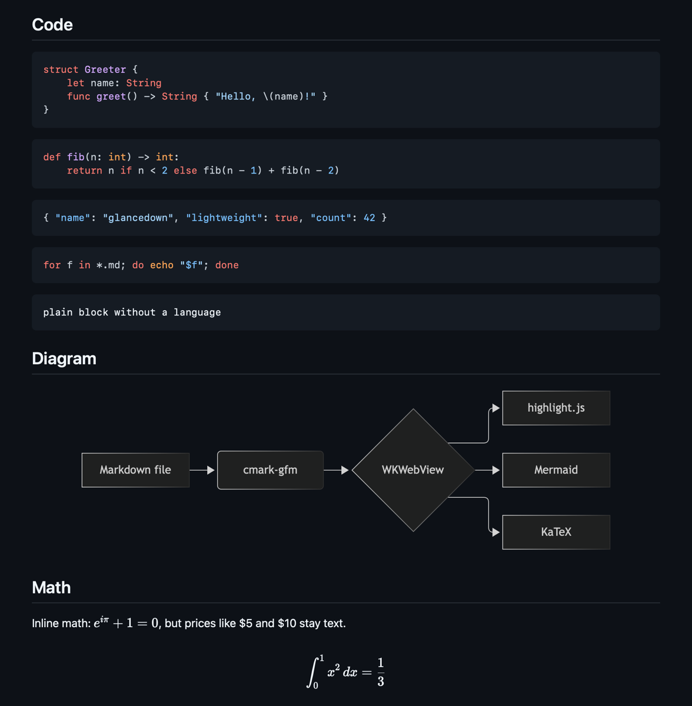

# Glancedown

A lightweight Markdown viewer for macOS, with a small companion editor. Native Swift apps, system WebKit, no Electron.

<p align="center">
  
  
</p>

## Features

- **GitHub-flavored Markdown**: tables, task lists, strikethrough, autolinks, footnotes.
- **Syntax highlighting** for 35+ common languages, offline, with light and dark themes and a copy button on every code block.
- **Zoom**: ⌘+ / ⌘− / ⌘0 or pinch. The level is remembered.
- **Live reload**: the view updates when the file changes on disk and keeps the scroll position, so it works well next to any editor.
- **Outline sidebar** built from the headings. Click to jump; the current section is highlighted.
- **Mermaid diagrams and KaTeX math** (`$…$`, `$$…$$`, fenced `math` blocks). The libraries load only when a document uses them.
- **Quick Look**: select a `.md` file in Finder and press Space.
- **Relative links and images** work: `other.md` opens in a new window, `../images/x.png` loads from your repository.
- Find (⌘F), Open in Editor (⌘E), Print and Save as PDF (⌘P), Show in Finder (⇧⌘R).

## Glancedown Editor

A separate, small app for writing Markdown, installed next to the viewer:

- Plain-text editor with Markdown syntax colouring (headings, emphasis, code, links, lists, quotes).
- Live preview beside the editor, rendered exactly like the viewer. The preview follows the section you are editing.
- Format shortcuts: Bold ⌘B, Italic ⌘I, Strikethrough ⇧⌘X, Inline code ⇧⌘C, Link ⌘K.
- Show or hide the preview with ⌥⌘P. ⌘+ / ⌘− change the editor font and the preview zoom together.
- Find and replace (⌘F) from the standard macOS find bar.
- Classic saving: ⌘S saves, and closing or quitting with unsaved changes asks first. There is no autosave.

The viewer's **Open in Editor** (⌘E) uses Glancedown Editor when it is installed. The viewer stays the default app for `.md` files.

## Install

### Download

Get the latest `.dmg` from [Releases](https://github.com/makcgr/glancedown/releases) and drag Glancedown (and, if you want it, Glancedown Editor) to Applications.

> Releases are not notarized yet. On first launch macOS blocks the app. Open **System Settings → Privacy & Security** and click **Open Anyway**, or run:
>
> ```bash
> xattr -dr com.apple.quarantine /Applications/Glancedown.app
> ```

### Homebrew

```bash
brew install --cask makcgr/tap/glancedown
```

### Build from source

Needs macOS 14+ and Swift 6 (Xcode 16+ or the Command Line Tools). A locally built app opens without Gatekeeper warnings.

```bash
git clone https://github.com/makcgr/glancedown.git
cd glancedown
./scripts/bundle.sh
cp -R build/Glancedown.app "build/Glancedown Editor.app" /Applications/
```

## Make it the default viewer

Finder → select any `.md` file → **Get Info** → **Open with: Glancedown** → **Change All…**

Or with [duti](https://github.com/moretension/duti):

```bash
duti -s io.github.makcgr.glancedown net.daringfireball.markdown viewer
```

To turn on the Quick Look preview, open Glancedown once, then check **System Settings → General → Login Items & Extensions → Quick Look**.

## Open in Editor

⌘E opens the file in the first editor it finds: Glancedown Editor, VS Code, Cursor, Zed, Sublime Text, BBEdit, Nova, then TextEdit. To pick one:

```bash
defaults write io.github.makcgr.glancedown editorBundleID com.microsoft.VSCode
```

## Security

Markdown files from the internet are untrusted, so Glancedown is strict by default:

- Raw HTML in Markdown is dropped, and `javascript:` / `file:` links are removed.
- The page runs under a Content Security Policy that allows only Glancedown's own bundled scripts and blocks all network requests from the page (remote `https` images still load).
- Local files are served only from the document's folder, or from the enclosing git repository. Paths that leave it, including through symlinks, are refused.
- The Quick Look extension is sandboxed.

## How it works

Markdown is parsed with [cmark-gfm](https://github.com/swiftlang/swift-cmark) (the parser GitHub uses) and shown in a `WKWebView`. highlight.js, Mermaid and KaTeX are bundled, so nothing is fetched from the network. On a file change only the article body is replaced, so scroll position and loaded scripts survive.

The design and dependencies are described in [docs/viewer-architecture.md](docs/viewer-architecture.md) and [docs/editor-architecture.md](docs/editor-architecture.md).

## License

MIT. See [LICENSE](LICENSE). Bundled components are listed in [THIRD_PARTY_NOTICES.md](THIRD_PARTY_NOTICES.md).
