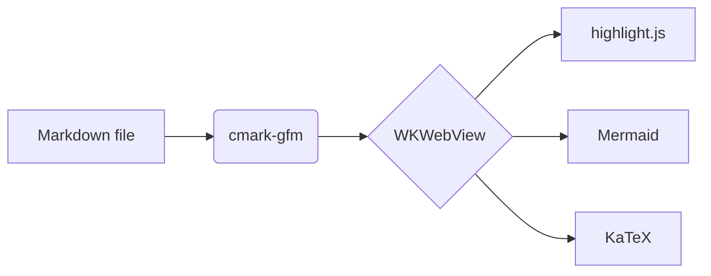

# Glancedown feature tour

A paragraph with **bold**, *italic*, ~~strikethrough~~, `inline code` and an autolink: https://example.com.

## Lists and tasks

- [x] Render GitHub-flavored Markdown
- [ ] Take over the world
  1. Nested ordered item
  2. Another one

## Table

| Feature | Status | Notes |
|:--------|:------:|------:|
| Tables | ✅ | right-aligned |
| Footnotes | ✅ | see below[^1] |

## Code

```swift
struct Greeter {
    let name: String
    func greet() -> String { "Hello, \(name)!" }
}
```

```python
def fib(n: int) -> int:
    return n if n < 2 else fib(n - 1) + fib(n - 2)
```

```json
{ "name": "glancedown", "lightweight": true, "count": 42 }
```

```bash
for f in *.md; do echo "$f"; done
```

```
plain block without a language
```

## Diagram



## Math

Inline math: $e^{i\pi} + 1 = 0$, but prices like $5 and $10 stay text.

$$
\int_0^1 x^2 \, dx = \frac{1}{3}
$$

```math
\sum_{k=1}^{n} k = \frac{n(n+1)}{2}
```

## Images and links


- [Relative link to another document](other.md)
- [Jump to the table](#table)

> A blockquote, for good measure.

[^1]: Footnotes render at the bottom.
